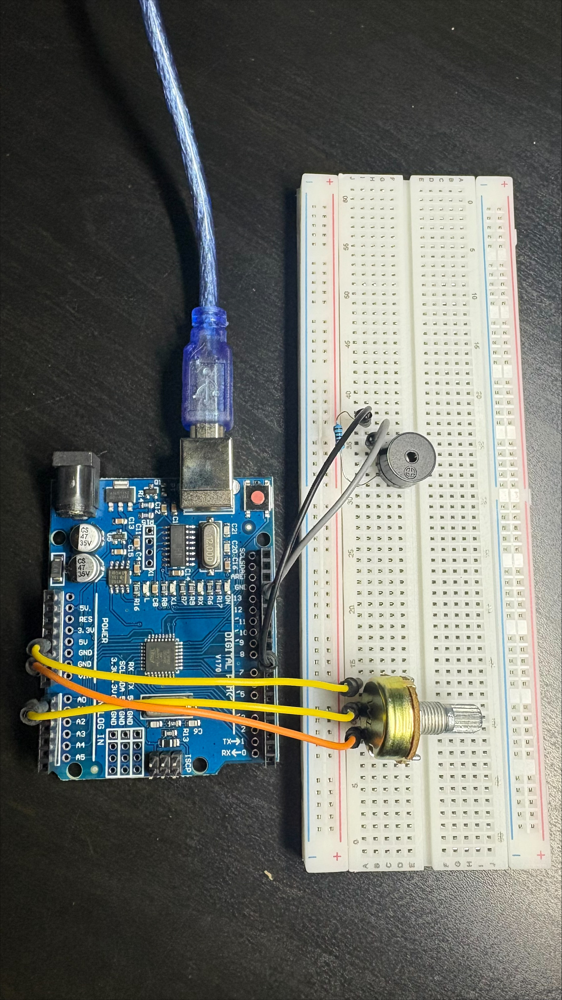

# Arduino Safe Cracker

A small Arduino game where you turn a potentiometer to find a hidden "combination". A buzzer plays a higher pitch the closer you get, and the game prints `CRACKED!` when you land on it.

## How it works

1. The potentiometer forms a voltage divider. Its middle pin sends a voltage between 0 V and 5 V to analog pin A0.
2. `analogRead()` converts that voltage into a number from 0 to 1023.
3. The sketch calculates the distance between the knob position and the hidden target: `abs(raw - target)`.
4. `map()` converts the distance into a frequency (200 Hz when far away, 2000 Hz at the target), and `tone()` plays it on the passive buzzer.
5. When the distance is under 20, the sketch prints `CRACKED!` to the Serial Monitor.

## Parts

- Arduino Uno (clone)
- 10 kΩ potentiometer
- Passive buzzer
- 1 kΩ resistor (keeps the buzzer quieter)
- Breadboard and jumper wires

## Run it

1. Open `safe_cracker/safe_cracker.ino` in the Arduino IDE.
2. Select **Arduino Uno** and your port, then upload.
3. Open the Serial Monitor at **9600 baud**.
4. Turn the knob and listen for the pitch rising as you approach the target (default `700`).

## What I learned

- Reading analog sensors and converting raw values with `map()`
- Generating tones with `tone()`
- Using the Serial Monitor to debug
- Breadboard wiring and finding a wiring fault (a mis-wired potentiometer that got warm)

## Planned next steps

- [ ] Servo that "unlocks" when the combination is found
- [ ] 1-digit 7-segment display showing how close you are
- [ ] Random target each game
- [ ] Hold-to-confirm and a limited number of attempts
